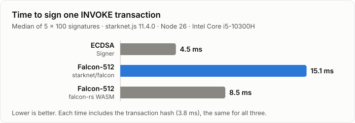

# Post-quantum signature (Falcon-512)

Starknet.js can sign the transactions of a Falcon-512 account. Falcon is a signature scheme designed to resist quantum computers. This page explains why it matters, which account to choose, how to use it, how two Falcon accounts can share a secret, and the limits.

## Why a post-quantum signature?

A standard Starknet account signs with ECDSA, on the Stark curve. The public key is computed from the private key. The reverse, finding the private key from the public key, is a problem that normal computers cannot solve: the security of ECDSA rests on it.

A large quantum computer could solve this problem. For NIST, the US standards agency, ECDSA is "no longer secure" against such a computer ([NISTIR 8105](https://nvlpubs.nist.gov/nistpubs/ir/2016/NIST.IR.8105.pdf), table 1). If a large quantum computer is ever built, it could compute the private key of an ECDSA account from its public key, which is visible on-chain. No such computer exists today: NIST describes these machines as "years or decades away" ([NIST PQC project](https://csrc.nist.gov/projects/post-quantum-cryptography)).

Changing the cryptography of a system takes years, so NIST prepares the change now:

- In 2022, NIST selected three post-quantum signature algorithms for standardization. Falcon is one of them, "for applications that need smaller signatures" ([NIST, July 2022](https://www.nist.gov/news-events/news/2022/07/nist-announces-first-four-quantum-resistant-cryptographic-algorithms)).
- In a draft report ([NIST IR 8547](https://csrc.nist.gov/pubs/ir/8547/ipd), November 2024), NIST proposes to disallow ECDSA in its standards after 2035.

Falcon rests on another kind of math problem, based on lattices, which is believed to be hard even for a quantum computer.

On Starknet, every account is a smart contract, so an account can check any kind of signature. Today, Falcon-512 signatures are checked by the two Falcon-512 accounts of [OpenZeppelin Contracts for Cairo](https://github.com/OpenZeppelin/cairo-contracts) (pre-release v4.1.0-rc.0), and by the [S2morrow](https://github.com/feltroidprime/s2morrow) account. The `starknet/falcon` entry point of Starknet.js signs for all of them.

## Which account?

|                           | OpenZeppelin, hint | OpenZeppelin, direct | S2morrow               |
| ------------------------- | ------------------ | -------------------- | ---------------------- |
| `accountType`             | `'oz-hint'`        | `'oz-direct'`        | `'s2morrow'` (default) |
| Signature                 | 60 felts           | 31 felts             | 61 felts               |
| L2 gas of a STRK transfer | 67 to 76 million   | 75 to 80 million     | 24.9 million           |
| Compared with ECDSA       | ×36 to ×41         | ×40 to ×43           | ×13.5                  |

A standard ECDSA account (OpenZeppelin) uses 1.85 million L2 gas for the same transfer. Measured with starknet-devnet 0.11.0. The fee is this gas multiplied by the price of the gas, which changes every day.

Use an OpenZeppelin account. It can change its key, move an existing OpenZeppelin account to Falcon, run outside executions (SNIP-9), upgrade its class, and share a secret with ML-KEM. OpenZeppelin offers two variants. With the hint, the signature carries a product that the account checks instead of computing it, so the check uses less gas. The direct variant computes this product itself: its signatures are shorter (31 felts instead of 60), and it accepts signatures from signing tools that cannot compute the hint, like another Falcon implementation. Choose the hint variant, unless your signing tool cannot make the hint. S2morrow uses about 3 times less gas, but it can do none of this: see [S2morrow (experimental)](#s2morrow-experimental).

The three account classes are declared on Sepolia and Mainnet:

| Account              | Class hash                                                           |
| -------------------- | -------------------------------------------------------------------- |
| OpenZeppelin, hint   | `0x014660ce3739fbde6e33d994cebd6a9fb20e800516b2e1b6c253d4d09baa9ae0` |
| OpenZeppelin, direct | `0x016111958d61eedfa5a950b608997abb4981b548f1862d620cc9247461ddeeb1` |
| S2morrow             | `0x37c7626b50ba517835c9556b53bce57cb6633704bb702f8c2f13a44cf151d5`   |

## Use an OpenZeppelin Falcon account

The Falcon tools are imported from `starknet/falcon`, an entry point of the `starknet` package: there is nothing else to install.

```typescript
import { Account, CallData, RpcProvider, cairo, hash } from 'starknet';
import { Falcon512Signer, falcon512 } from 'starknet/falcon';
```

### Create a key pair

```typescript
const { secretKey, publicKey } = falcon512.generateKeyPair();
const falconSigner = new Falcon512Signer(secretKey, { accountType: 'oz-hint' });
```

The secret key is a `Uint8Array` of 1281 bytes, and the public key a `Uint8Array` of 897 bytes. The `accountType` option tells the signer which account it signs for: `'oz-hint'` or `'oz-direct'`, as the class of the account. With a wrong `accountType`, the account rejects every transaction.

:::warning
Store the secret key safely: whoever has it controls the account. `Falcon512Signer` also accepts the key as a hex string, but a string cannot be erased from memory: prefer a `Uint8Array`.
:::

### Compute the address

The constructor of the account takes the public key as an array of 29 felts, given by `getPackedPublicKey()`. As for any array, its length comes first.

```typescript
const myProvider = new RpcProvider({ nodeUrl: `${myNodeUrl}` });

// OpenZeppelin, hint. Direct: 0x016111958d61eedfa5a950b608997abb4981b548f1862d620cc9247461ddeeb1
const falconClassHash = '0x014660ce3739fbde6e33d994cebd6a9fb20e800516b2e1b6c253d4d09baa9ae0';
const packedPublicKey = falconSigner.getPackedPublicKey(); // 29 felts
const constructorCalldata = CallData.compile({ public_key: packedPublicKey }); // ['29', …]
// The salt can be any felt. With the first felt of the key, the address depends on the key only.
const addressSalt = packedPublicKey[0];
const falconAddress = hash.calculateContractAddressFromHash(
  addressSalt,
  falconClassHash,
  constructorCalldata,
  0 // deployer address: 0 when the account deploys itself
);
console.log('Precalculated account address =', falconAddress);
```

Then send STRK to this address, as for [any new account](./create_account.md).

### Deploy the account

```typescript
const falconAccount = new Account({
  provider: myProvider,
  address: falconAddress,
  signer: falconSigner,
});

const { transaction_hash } = await falconAccount.deployAccount(
  {
    classHash: falconClassHash,
    constructorCalldata,
    addressSalt,
    contractAddress: falconAddress,
  },
  { skipValidate: false }
);
await myProvider.waitForTransaction(transaction_hash);
```

### Send transactions

`falconAccount` works like any other account. For example, a STRK transfer:

```typescript
const strkAddress = '0x04718f5a0fc34cc1af16a1cdee98ffb20c31f5cd61d6ab07201858f4287c938d';
const { transaction_hash: transferHash } = await falconAccount.execute(
  {
    contractAddress: strkAddress,
    entrypoint: 'transfer',
    calldata: { recipient: recipientAddress, amount: cairo.uint256(10n ** 15n) },
  },
  { skipValidate: false }
);
await myProvider.waitForTransaction(transferHash);
```

`declare` takes the same `{ skipValidate: false }` option.

:::info Fees
Checking a Falcon signature on-chain costs much more than checking an ECDSA one: with an OpenZeppelin Falcon account, a STRK transfer uses 36 to 43 times more L2 gas (see [Which account?](#which-account)).

By default, Starknet.js estimates the fees without running the validation of the account, so the estimate would miss this cost. Always pass `{ skipValidate: false }`, as in the examples above.
:::

### Sign and verify a message

Messages follow SNIP-12, as with any account (see [Signature](./signature.md#sign-and-verify-following-eip712)). A signature has 60 felts with the hint, 31 felts without it.

```typescript
const signature = await falconAccount.signMessage(myTypedData);

// Off-chain, with the public key and the accountType of the account:
const isValid = falcon512.verifyMessage(myTypedData, signature, publicKey, falconAccount.address, {
  accountType: 'oz-hint',
});

// On-chain, with the account contract:
const isValidOnChain = await myProvider.verifyMessageInStarknet(
  myTypedData,
  signature,
  falconAccount.address
);
```

Anybody can read the public key of the account: `get_public_key` returns the length 29, then the 29 felts of the key.

```typescript
const storedKey = await myProvider.callContract({
  contractAddress: falconAccount.address,
  entrypoint: 'get_public_key',
});
const isValid2 = falcon512.verifyMessage(
  myTypedData,
  signature,
  storedKey.slice(1),
  falconAccount.address,
  { accountType: 'oz-hint' }
);
```

### Change the key

An OpenZeppelin account can change its key, and keep its address. The account calls its own `set_public_key`: the current key signs this transaction, and the new key signs its acceptance.

```typescript
// A new key pair, created as in "Create a key pair". Store its secret key as safely as the first one.
const { secretKey: newSecretKey } = falcon512.generateKeyPair();
const newSigner = new Falcon512Signer(newSecretKey, { accountType: 'oz-hint' });
const acceptance = await newSigner.signOwnershipAcceptance(
  falconAccount.address,
  falconSigner.getPackedPublicKey() // the current key of the account
);
const { transaction_hash: changeHash } = await falconAccount.execute(
  {
    contractAddress: falconAccount.address,
    entrypoint: 'set_public_key',
    calldata: CallData.compile({
      new_public_key: newSigner.getPackedPublicKey(),
      signature: acceptance,
    }),
  },
  { skipValidate: false }
);
await myProvider.waitForTransaction(changeHash);
// From now on, sign with newSigner:
const renewedAccount = new Account({
  provider: myProvider,
  address: falconAccount.address,
  signer: newSigner,
});
```

### Move an existing OpenZeppelin account to Falcon

An OpenZeppelin account with a Stark (or Ethereum) key can become a Falcon account. It keeps its address, its funds and its history. The account must be an OpenZeppelin `AccountUpgradeable` or `EthAccountUpgradeable`: its ABI has `upgrade`. Argent, Braavos and S2morrow accounts cannot do it.

Three rules:

1. **One transaction, signed by the current key**, with two calls to the account itself, in this order: `upgrade` to the Falcon class, then `set_public_key` with the Falcon key. Never send `upgrade` alone: the account would become unusable.
2. **The new Falcon key signs the acceptance**, with an empty current key: `[]`.
3. **The same `accountType`** as the Falcon class, for the acceptance and for the signer afterwards.

```typescript
// The existing account, with its Stark key.
const starkAccount = new Account({
  provider: myProvider,
  address: accountAddress,
  signer: starkPrivateKey,
});
// The new Falcon key. Store its secret key safely BEFORE you send the transaction.
const { secretKey } = falcon512.generateKeyPair();
const falconSigner = new Falcon512Signer(secretKey, { accountType: 'oz-hint' });
const acceptance = await falconSigner.signOwnershipAcceptance(accountAddress, []);
const { transaction_hash: migrationHash } = await starkAccount.execute(
  [
    {
      contractAddress: accountAddress,
      entrypoint: 'upgrade',
      calldata: CallData.compile({ new_class_hash: falconClassHash }),
    },
    {
      contractAddress: accountAddress,
      entrypoint: 'set_public_key',
      calldata: CallData.compile({
        new_public_key: falconSigner.getPackedPublicKey(),
        signature: acceptance,
      }),
    },
  ],
  { skipValidate: false }
);
// waitForTransaction does not throw when a transaction fails: check it.
const receipt = await myProvider.waitForTransaction(migrationHash);
if (!receipt.isSuccess()) throw new Error('Migration failed: the account keeps its Stark key.');
// From now on, the same address signs with Falcon:
const falconAccount = new Account({
  provider: myProvider,
  address: accountAddress,
  signer: falconSigner,
});
```

## S2morrow (experimental)

The [S2morrow](https://github.com/feltroidprime/s2morrow) account uses about 3 times less gas than an OpenZeppelin account. But it cannot change its key: a new key means a new account. It has no outside execution (SNIP-9), and it cannot upgrade its class. Its key cannot be read on-chain, so it cannot share a secret with ML-KEM. No audit is published, and its repository has not changed since March 2026.

The steps are the ones of an OpenZeppelin account, with three differences:

```typescript
const falconSigner = new Falcon512Signer(secretKey); // 's2morrow' is the default accountType
const falconClassHash = '0x37c7626b50ba517835c9556b53bce57cb6633704bb702f8c2f13a44cf151d5';
const constructorCalldata = CallData.compile(falconSigner.getPackedPublicKey()); // no length
```

Its signatures have 61 felts. To check one off-chain, you need the public key from its owner: the account cannot give it.

### Keys created with falcon-rs

If your secret key comes from falcon-rs (3584 bytes), build the signer with:

```typescript
const falconSigner = Falcon512Signer.fromFalconRs(falconRsSecretKey);
```

:::warning
falcon-rs derives the random seed of each signature from its public salt, so the signatures it produced may leak information about the secret key. Use such a key only to keep using an existing account. For real funds, generate a new key with `falcon512.generateKeyPair()`. The S2morrow account cannot change its key, so this means a new account; an OpenZeppelin account can [change its key](#change-the-key).
:::

## Share a secret between two Falcon accounts

Falcon only signs. To share a secret, for example the key of an encrypted message, two OpenZeppelin Falcon accounts use ML-KEM-768 (FIPS 203), a post-quantum key exchange, with the `mlkem` namespace of `starknet/falcon`. Each side signs its part with its account: a wallet can do it with `signMessage`.

Every part of the exchange resists quantum computers. NIST ranks these algorithms in security categories, from 1 (as hard to break as AES-128) to 5 (as hard as AES-256): Falcon-512 is in category 1, ML-KEM-768 in category 3, and AES-256 in category 5. So the whole exchange is at category 1, the level of Falcon-512.


```typescript
import { gcm } from '@noble/ciphers/aes.js';
import { bytesToUtf8, randomBytes, utf8ToBytes } from '@noble/ciphers/utils.js';
import { mlkem } from 'starknet/falcon';

// aliceAccount and bobAccount: two deployed OpenZeppelin Falcon accounts (Account or WalletAccount).

// 1. Alice creates an ML-KEM key, valid for one hour, and signs it with her account.
const validUntil = Math.floor(Date.now() / 1000) + 3600; // in seconds
const aliceKey = mlkem.createKey(await myProvider.getChainId(), validUntil);
const signedKey = {
  keyOwnerAddress: aliceAccount.address,
  publicKey: aliceKey.publicKey,
  validUntil,
  signature: await aliceAccount.signMessage(aliceKey.typedData),
};
// Alice keeps aliceKey.seed secret, and sends signedKey to Bob.

// 2. encapsulate first checks the signature of Alice, with her Falcon key read on-chain, and throws
//    if it is not valid. Only then does it give Bob the secret and a capsule. Bob signs the capsule.
const bobSide = await mlkem.encapsulate(myProvider, signedKey, bobAccount.address);
const signedCapsule = {
  senderAddress: bobAccount.address,
  capsule: bobSide.capsule,
  timestamp: bobSide.timestamp,
  signature: await bobAccount.signMessage(bobSide.typedData),
};
// Bob keeps bobSide.sharedSecret secret, and sends signedCapsule to Alice.

// 3. decapsulate first checks the signature of Bob, with his Falcon key read on-chain, and throws
//    if it is not valid. Only then does it open the capsule: Alice gets the same secret.
const aliceSecret = await mlkem.decapsulate(
  myProvider,
  signedCapsule,
  aliceAccount.address,
  aliceKey.seed
);

// 4. Alice encrypts a text with AES-256-GCM. The secret (32 bytes) is the key.
const nonce = randomBytes(12); // a new nonce for each message
const encrypted = gcm(aliceSecret, nonce).encrypt(utf8ToBytes('Meet me at noon.'));
// Alice sends nonce and encrypted to Bob.

// 5. Bob decrypts the text with his copy of the secret.
const text = bytesToUtf8(gcm(bobSide.sharedSecret, nonce).decrypt(encrypted));
// text = 'Meet me at noon.'
```

- `encapsulate` and `decapsulate` check each signature with the Falcon key of the account, read on-chain (`get_public_key`). They refuse any other account, like a Stark account or an S2morrow account.
- Only the capsule travels, and only the seed of Alice can open it. If the seed leaks, every capsule made for its key can be opened: keep `validUntil` short, and store the seed safely.
- With AES-GCM, never use the same nonce twice with the same key. `decrypt` throws if the encrypted text was changed. `gcm` comes from `@noble/ciphers` (`npm install @noble/ciphers`); any AES-GCM works.
- A capsule received twice gives the same secret again: refusing it is the job of the application.

## Performance



The falcon-rs WASM is shown for comparison only: its signatures may leak information about the secret key (see [Keys created with falcon-rs](#keys-created-with-falcon-rs)).

## Limits

- **Falcon, not yet FN-DSA.** This is Falcon as submitted to Round 3 of the NIST process. The NIST standard based on Falcon, FN-DSA (FIPS 206), is still in development ([NIST](https://csrc.nist.gov/projects/post-quantum-cryptography/post-quantum-cryptography-standardization), August 2026). The README of noble, the library this code comes from, says that FN-DSA would most likely be incompatible with Falcon.
- **No published audit of the accounts.** The Falcon accounts of OpenZeppelin come with the pre-release v4.1.0-rc.0, after the last audit of OpenZeppelin Contracts for Cairo (v4.0.0, July 2026). The S2morrow repository mentions no audit. These account contracts come from OpenZeppelin and S2morrow, not from Starknet.js.
- **A copy of noble, without independent audit.** The Falcon and ML-KEM code is a copy of [`@noble/post-quantum`](https://github.com/paulmillr/noble-post-quantum) 0.7.1, with one addition for Falcon: signing a hash point computed outside noble. This addition is proposed to noble ([PR #55](https://github.com/paulmillr/noble-post-quantum/pull/55)). Once noble publishes it, Starknet.js will use the npm package, with no change for you. noble has no independent audit: its author audited version 0.6.1 (April 2026).
- **Not constant-time.** The time needed to sign can depend on the secret key. Do not sign on a machine where an attacker can measure this time closely, like a shared server.

Complete scripts for a devnet are in the [Starknet.js workshop](https://github.com/PhilippeR26/starknet.js-workshop-typescript/tree/main/src/scripts/signature/falcon512): `OZfalcon512/` for the OpenZeppelin accounts (deployment, key change, migration, shared secret), and `snjs/` for S2morrow.

For more details, see the [security notes](https://github.com/starknet-io/starknet.js/blob/develop/src/falcon/SECURITY.md) of `starknet/falcon`, and its [API](../../API/falcon/index.md).
